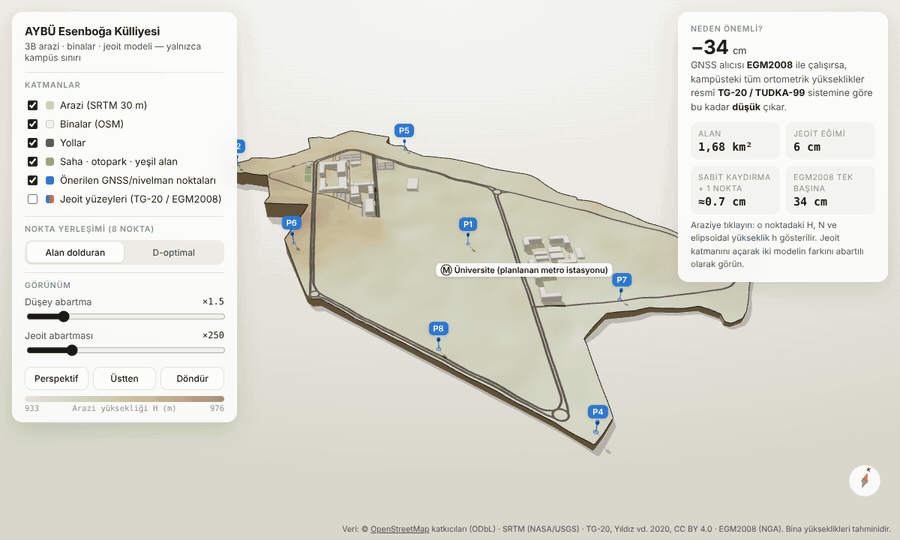
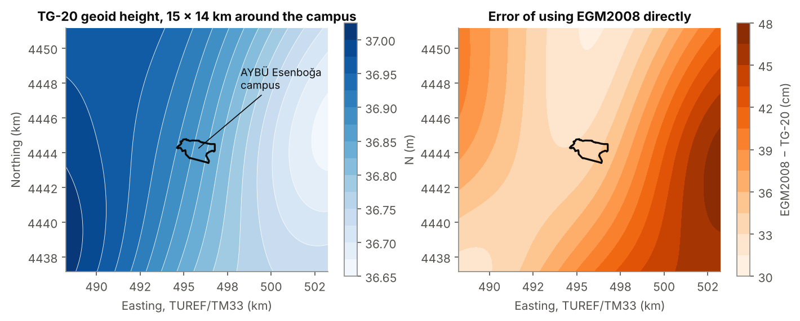
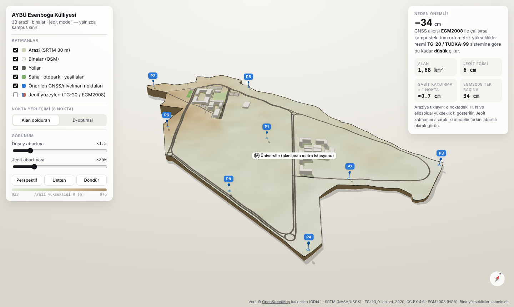
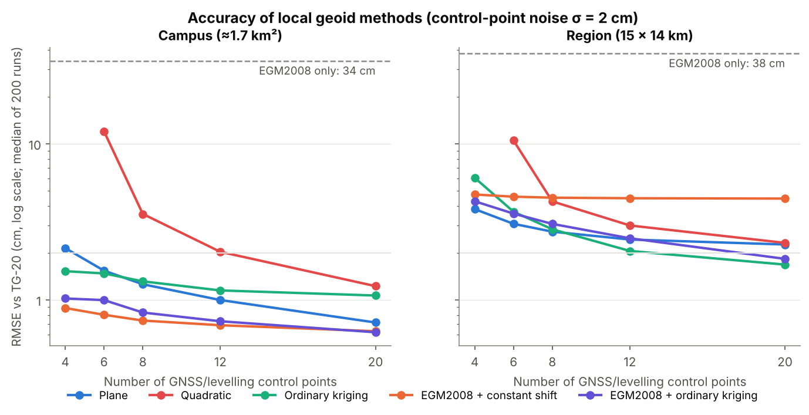
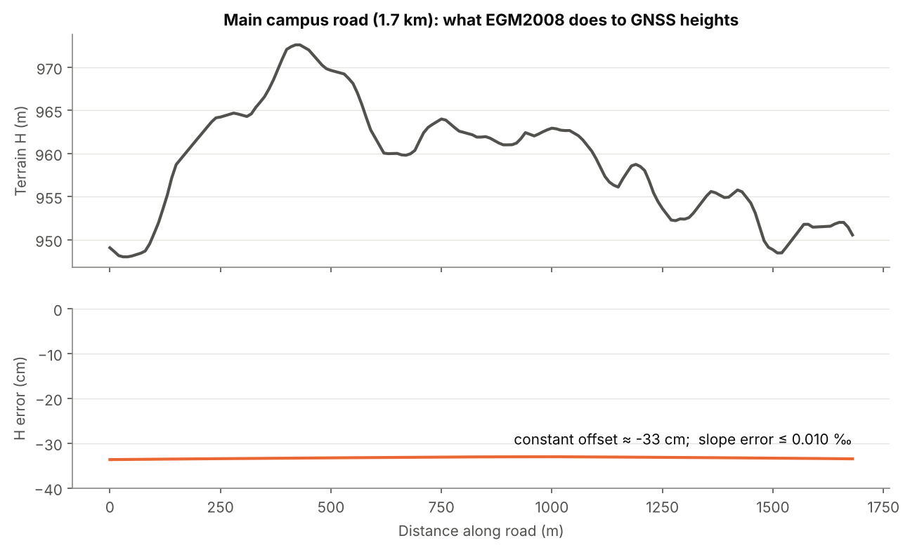
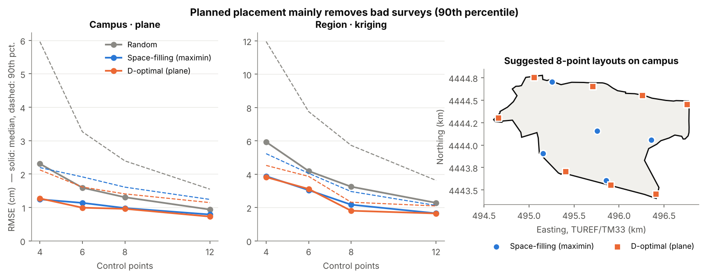

# Local Geoid Modelling for GNSS Heighting — AYBÜ Esenboğa Campus, Ankara

How accurately can a site engineer turn GNSS ellipsoidal heights into usable
orthometric heights on a university campus? Which local geoid method should
they use, and how many GNSS/levelling control points do they need?

This repository answers those questions with **open data only**, on the
Ankara Yıldırım Beyazıt University (AYBÜ) Esenboğa Campus (≈1.7 km²) and on a
15 × 14 km region around it.



> Status: **v0.1, a simulation study.** The control points are simulated from
> the official Turkish geoid model. No field measurements yet (see *Roadmap*).



## 3D campus model (in the browser)

`docs/index.html` is a self-contained Three.js viewer of the campus only:
- terrain from SRTM 30 m, drawn as a diorama cut to the campus boundary
- OSM buildings, roads, pitches and parking
- the suggested GNSS/levelling points
- the TG-20 and EGM2008 geoid surfaces, vertically exaggerated

Click the terrain to see *H*, *N* (both models), *h*, and the height error
from using EGM2008 at that spot.
Open the file locally, or view it online via GitHub Pages
(*Settings → Pages → Deploy from a branch → `main` / `/docs`*):
<https://mustafabugrabekdemir.github.io/local-geoid-esenboga/>
Rebuild it with `python scripts/build_web.py`.



## Key findings (v0.1)

| | Campus (1.7 km²) | Region (15 × 14 km) |
|---|---|---|
| Geoid variation inside the area (TG-20) | ≈ 6 cm | ≈ 36 cm |
| **EGM2008 used directly** | **34 cm** height error | **38 cm** height error |
| Best method, 8 control points, σ = 2 cm | EGM2008 + constant shift: **0.7 cm** | Plane / kriging: **2.7–2.8 cm** |
| 2nd-order polynomial, 8 points | 3.5 cm (overfits) | 4.3 cm |

*RMSE against TG-20 on independent check points; median of 200 Monte-Carlo runs.*

1. **Using the global model blindly is the main danger.** Many GNSS receivers
   and GIS packages use EGM2008 by default. Here that puts every height
   ≈ 33–34 cm too low relative to the national height datum (TUDKA-99/TG-20).
   This matters for tying into municipal sewer and stormwater inverts, flood
   levels and zoning height references.
2. **On campus scale the error is almost a pure offset.** Along the 1.7 km
   main road the error changes by only 6 mm (slope error ≤ 0.01 ‰). Typical
   minimum sewer gradients are around 3–5 ‰, so relative heights from GNSS are
   safe. A *single* benchmark tie (EGM2008 + constant shift) already gives
   sub-centimetre accuracy.
3. **More parameters are not better.** The 6-parameter quadratic surface,
   the classic coursework approach, overfits with few points. A plane, or
   remove–restore with EGM2008, is more robust.
4. **At regional scale (~15 km) the geoid shape matters.** A constant shift
   is no longer enough (4.5 cm). Plane, kriging and thin-plate splines reach
   2–3 cm with 8–12 well-spread points.

5. **Where you put the points matters more than how many.** A planned layout
   (space-filling or D-optimal) mostly protects against *bad* surveys. With 6
   points on campus, the 90th-percentile error of the plane model drops from
   3.3 to 1.6 cm. With 6 points in the region, the kriging error drops from
   7.8 to about 4 cm. Medians improve less. The suggested layouts are saved in
   `data/processed/recommended_layouts.csv`.





## Why this matters for civil engineering

GNSS gives ellipsoidal height *h*. Drainage, road grades, foundations and
flood design need orthometric height *H* = *h* − *N*, which is the height
that tells water which way to flow. Türkiye's Large-Scale Map Production
Regulation (BÖHHBÜY) allows *N* to come from a local GNSS/levelling geoid
model. This project quantifies the choice of method and control-point count
for a real construction site (an expanding university campus).

## Data (all open)

| Dataset | Use | Source / licence |
|---|---|---|
| TG-20 Turkish hybrid geoid, 5′ grid | reference ("true") geoid | Yıldız et al. 2020, GFZ Data Services, doi:10.5880/isg.2020.011, CC BY 4.0 (via ISG) |
| EGM2008, 2.5′ grid | global model to compare and use for remove–restore | NGA; PROJ-data `us_nga_egm08_25.tif` |
| Campus boundary, buildings, roads | study area | © OpenStreetMap contributors, ODbL (relation 17692965) |
| SRTM 1″ terrain heights (~30 m grid) | 3D terrain, road profile, map | NASA/USGS, public domain, via OpenTopoData |

Only small clips around Ankara are stored in `data/raw/`.

## Method

1. Simulate a GNSS/levelling survey: *n* control points (4–20) placed randomly
   in the area. Each observed *N* is TG-20 plus Gaussian noise
   (σ = 0.5–5 cm, default 2 cm).
2. Fit each method to the control points:
   - EGM2008 only
   - plane and quadratic least-squares polynomial (with *m₀*, covariance and t-tests)
   - thin-plate spline
   - ordinary kriging
   - remove–restore: EGM2008 + constant / plane / kriging residual surface
3. Evaluate against TG-20 on a dense grid of independent check points.
   Repeat 200×.
4. Placement study (`scripts/run_placement.py`): compare three layouts:
   - random points
   - greedy maximin (space-filling) points on a candidate grid
   - greedy D-optimal points for the planar trend

   Designed points get a ±25 m (campus) or ±250 m (region) field jitter.

Coordinates are in TUREF/TM33 (EPSG:5255).

## Limitations

- TG-20 is treated as the truth. Its own accuracy is ≈1–6 cm, and the 5′ grid
  smooths out wavelengths shorter than about 10 km. Real-world errors will
  therefore be somewhat larger than the simulated ones.
- The 34 cm EGM2008 − TG-20 difference includes datum and tide-system
  differences (WGS84 tide-free vs GRS80/ITRF96 zero-tide, TUDKA-99 datum),
  not only EGM2008 model error. For a practitioner in Türkiye it is
  nevertheless the error relative to official heights.
- SRTM heights are used only for illustration. SRTM is a surface model, so
  trees and buildings are partly included.
- OSM has no storey counts for these buildings. Heights in the 3D model are
  assumed by building type.

## Reproduce

```bash
pip install -r requirements.txt
python scripts/run_experiments.py --reps 200   # ~1 min
python scripts/run_placement.py --reps 150     # ~1 min
python scripts/make_figures.py
python scripts/build_web.py                    # 3D viewer -> docs/index.html
python scripts/make_demo_gif.py                # optional: figures/demo.gif (needs Playwright + ffmpeg)
pytest -q
```

## Roadmap

- [x] Control-point placement optimisation
- [x] Interactive 3D campus model in the browser (`docs/`)
- [ ] Field campaign on campus: static GNSS (TUSAGA-Aktif/CORS) + levelling on
      the suggested points → replace simulated points with real ones
- [ ] Least-squares collocation and an ML baseline
- [ ] Export the local model as a GeoTIFF / PROJ grid for QGIS and field software

## Licence

Code: MIT (see `LICENSE`). Data keep their own licences (see `data/README.md`).
The OSM-derived files are under ODbL.

## Origin

This started as a 2023 undergraduate exercise (Hacettepe University, GMT423
Height Systems). That exercise fitted a quadratic surface to 20 points.
This version rebuilds it from scratch on open data and fixes a sign bug in the
original fitting code (see `tests/test_models.py`).

---

## Türkçe özet

Bu çalışma, AYBÜ Esenboğa Külliyesi'nde (≈1,7 km²) ve çevresindeki
15 × 14 km'lik alanda GNSS elipsoidal yüksekliklerinin ortometrik yüksekliğe
dönüştürülmesi için yerel jeoit yöntemlerini yalnızca açık verilerle
karşılaştırıyor.

Resmî TG-20 jeoit modeli referans alındı. GNSS/nivelman noktaları benzetimle
üretildi.

**Sonuçlar:**
- EGM2008'in doğrudan kullanılması kampüste yaklaşık **34 cm** yükseklik hatası
  veriyor.
- Bu hata kampüs ölçeğinde neredeyse sabit bir kayıklık; eğim hatası
  ≤ 0,01 ‰ düzeyinde.
- Tek bir nivelman noktasıyla yapılan kaydırma bile santimetre altı doğruluk
  sağlıyor.
- 15 km ölçeğinde düzlem veya kriging ile 8–12 noktada 2–3 cm doğruluğa
  ulaşılıyor.
- İkinci dereceden polinom az noktayla aşırı uyum gösteriyor.
- Noktaların planlı yerleştirilmesi (maximin / D-optimal), özellikle kötü
  sonuçlanan ölçüm senaryolarını (90. yüzdelik) yaklaşık yarıya indiriyor.

İnşaat mühendisliği açısından bu, kanalizasyon, yağmur suyu ve yol kotlarının
belediye altyapısına doğru bağlanması için jeoit modeli seçiminin önemini
sayısal olarak ortaya koyuyor.
