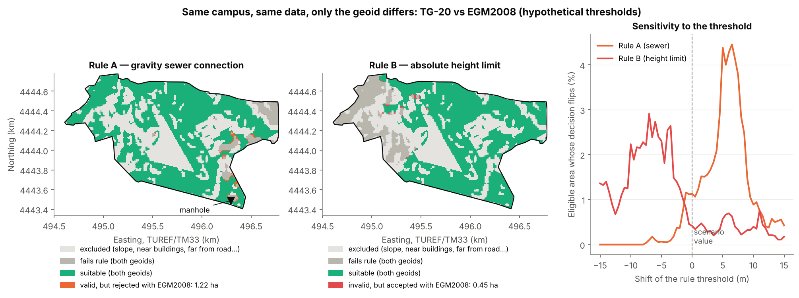

# Local Geoid Modelling for GNSS Heighting — AYBÜ Esenboğa Campus, Ankara

How accurately can a site engineer turn GNSS ellipsoidal heights into usable
orthometric heights on a university campus? Which local geoid method should
they use, and how many GNSS/levelling control points do they need?

This repository answers those questions with **open data only**, on the
Ankara Yıldırım Beyazıt University (AYBÜ) Esenboğa Campus (≈1.7 km²) and on a
15 × 14 km region around it.


> Status: **v0.1, a simulation study.** The control points are simulated from
> the official Turkish geoid model. No field measurements yet (see *Roadmap*).


## 3D campus model (in the browser)

`docs/index.html` is a self-contained Three.js viewer of the campus only:
- terrain from SRTM 30 m, drawn as a diorama cut to the campus boundary
- OSM buildings, roads, pitches and parking
- the suggested GNSS/levelling points
- the TG-20 and EGM2008 geoid surfaces, vertically exaggerated

Click the terrain to see *H*, *N* (both models), *h*, and the height error
from using EGM2008 at that spot.
Open the file locally, or view it online via GitHub Pages
(*Settings → Pages → Deploy from a branch → `main` / `/docs`*):
<https://mustafabugrabekdemir.github.io/local-geoid-esenboga/>
Rebuild it with `python scripts/build_web.py`.


## Key findings (v0.1)

| | Campus (1.7 km²) | Region (15 × 14 km) |
|---|---|---|
| Geoid variation inside the area (TG-20) | ≈ 6 cm | ≈ 36 cm |
| **EGM2008 used directly** | **34 cm** height error | **38 cm** height error |
| Best method, 8 control points, σ = 2 cm | EGM2008 + constant shift: **0.7 cm** | Plane / kriging: **2.7–2.8 cm** |
| 2nd-order polynomial, 8 points | 3.5 cm (overfits) | 4.3 cm |

*RMSE against TG-20 on independent check points; median of 200 Monte-Carlo runs.*

1. **Using the global model blindly is the main danger.** If EGM2008 is used
   instead of TG-20, for example because no national geoid is configured in
   the GNSS or GIS software, every height here comes out ≈ 33–34 cm too low
   relative to the national height datum (TUDKA-99, realised by TG-20).
   This matters for tying into municipal sewer and stormwater inverts, flood
   levels and zoning height references.
2. **On campus scale the error is almost a pure offset.** Along the 1.7 km
   main road the error changes by only 6 mm (slope error ≤ 0.01 ‰). That is far
   below any practical design gradient, so *relative* heights from GNSS are
   safe. A *single* benchmark tie (EGM2008 + constant shift) already gives
   sub-centimetre accuracy.
3. **More parameters are not better.** The 6-parameter quadratic surface,
   the classic coursework approach, overfits with few points. A plane, or
   remove–restore with EGM2008, is more robust.
4. **At regional scale (~15 km) the geoid shape matters.** A constant shift
   is no longer enough (4.5 cm). Plane, kriging and thin-plate splines reach
   2–3 cm with 8–12 well-spread points.

5. **Where you put the points matters as much as how many.** A planned layout
   (space-filling or D-optimal) mostly protects against *bad* surveys. With 6
   points on campus, the 90th-percentile error of the plane model drops from
   3.3 cm (random) to 1.6–1.9 cm, about what 12 random points achieve.
   With 6 points in the region, the kriging error drops from 7.8 to about
   4 cm. Medians improve less. The suggested layouts are saved in
   `data/processed/recommended_layouts.csv`.


## Why this matters for decision support (MIS · SDSS · GeoBI)

A spatial decision support system (SDSS) or a GeoBI dashboard is only as
good as the heights it is fed. A wrong vertical datum is a dangerous error
for three reasons:

- **It is silent.** In this case study the error is a smooth, almost constant
  offset of about 34 cm. Nothing looks wrong on a map or in a dashboard.
- **It is systematic.** The offset does not average out the way random noise
  does.
- **It is hard to see in the metadata.** A column called `elevation` rarely
  says which geoid it refers to.

The literature shows how this distorts decisions:

- **Risk and site selection.** A review of 385 coastal hazard studies found
  that more than 90 % took sea level from global geoid models instead of
  measured sea level. As a result, exposure to sea-level rise was
  underestimated (Seeger & Minderhoud, *Nature*, 2026). In the US, NOAA's
  GRAV-D programme notes that a 50 cm vertical datum error can lead to
  thousands of acres of wrongly predicted inundation.
- **Uncertainty-aware decision support.** A rigorous approach to data
  quality has several steps:
  1. estimate data quality when the data are collected;
  2. record it as metadata;
  3. propagate the uncertainty through processing models;
  4. use it in decision support tools;
  5. communicate it to the user with the final product.

  (Laskey et al., 2010)

  This repository follows that chain for one variable, the height reference.
  It measures the error, attaches an accuracy statement to each method
  (median and 90th percentile), and shows the consequence at the point of
  use in the 3D viewer.
- **Drone logistics and low-altitude operations.** Vertical references are
  fragmented:
  - manned aviation uses barometric altitude
  - maps use mean sea level
  - obstacle avoidance uses height above ground

  This fragmentation creates ambiguity for autonomous systems, so a single
  ellipsoid-based reference has been proposed (Yan et al., 2026). Software
  adds to the mix. GNSS receivers natively output ellipsoidal heights, while
  Esri's Drone2Map documentation notes that ArcGIS Online and ArcGIS Pro use
  the EGM96 geoid for published 3D meshes. A delivery or inspection workflow
  that mixes these references without conversion gets heights that are off
  by tens of metres (h vs H) or by decimetres (EGM vs national geoid).

**Take-aways for an information system.** Store the vertical CRS with
every height. For example, use the compound reference TUREF/TM33 + TUDKA-99,
and convert GNSS heights with TG-20. Put the geoid model in the data lineage,
and validate incoming heights against it. The campus 3D model in `docs/` is a
small digital-twin example: it puts the decision-relevant number (the height
error at a clicked location) in front of the user instead of hiding it in a
processing step.

### SDSS scenario on campus: does the geoid change the decision?

`scripts/run_sdss.py` screens every 10 m cell of the campus for a new
building twice with identical inputs. The only difference between the runs
is the geoid used to turn GNSS heights into orthometric heights: TG-20
(reference) or EGM2008.

- **Site constraints (same in both runs):** slope ≤ 8 %, ≥ 15 m from
  existing buildings, not on pitches or parking, ≤ 200 m from a road.
  This leaves 108 ha of the 168 ha campus.
- **Rule A, gravity sewer:** the building must drain by gravity to a manhole
  at the south-east roundabout, with invert 2.5 m below ground, 1.5 m pipe
  cover and 0.5 % fall. Lower heights make this rule fail. With EGM2008,
  **1.22 ha of valid sites are rejected**: lost options.
- **Rule B, absolute height limit:** a 20 m building must stay below
  975 m, the kind of limit an obstacle-limitation surface imposes. Lower
  heights make this rule pass. With EGM2008, **0.45 ha of sites that break
  the limit are approved**: an unsafe decision.

All thresholds are **hypothetical**. They are not real municipal or aviation
values; they only place the decision boundary across the campus. Shifting
either threshold by ±15 m changes the flipped share of the 108 ha between
0 and ~4 %.

The share is small, but the errors are not random: they fall exactly on
the borderline sites, and their direction depends on the rule. The same
34 cm bias makes one rule too cautious and the other unsafe. The 3D viewer
shows both rules as a terrain colouring (*Arazi rengi → A / B*).



Another MIS-oriented extension would be a "vertical-datum check" service
for a spatial data warehouse.

<sub>References:
Seeger, K. & Minderhoud, P. S. J. (2026). Sea level much higher than assumed
in most coastal hazard assessments. *Nature*. doi:10.1038/s41586-026-10196-1.
·
NOAA GRAV-D programme, as reported in "Airborne Gravity Survey for Floodwater
Inundation Prediction", *Hydro International*.
·
Laskey, K. B., Wright, E. J. & da Costa, P. C. G. (2010). Envisioning
uncertainty in geospatial information. *International Journal of Approximate
Reasoning* 51, 209–223. doi:10.1016/j.ijar.2009.05.011.
·
Yan, S. et al. (2026). The Vertical Challenge of Low-Altitude Economy: Why We
Need a Unified Height System? arXiv:2603.04866.
·
Esri, ArcGIS Drone2Map 2.3 help, "Vertical reference".</sub>

## Data (all open)

| Dataset | Use | Source / licence |
|---|---|---|
| TG-20 Turkish hybrid geoid, 5′ grid | reference ("true") geoid | Yıldız et al. 2020, GFZ Data Services, doi:10.5880/isg.2020.011, CC BY 4.0 (via ISG) |
| EGM2008, 2.5′ grid | global model to compare and use for remove–restore | NGA; PROJ-data `us_nga_egm08_25.tif` |
| Campus boundary, buildings, roads | study area | © OpenStreetMap contributors, ODbL (relation 17692965) |
| SRTM 1″ terrain heights (~30 m grid) | 3D terrain, road profile, map | NASA/USGS, public domain, via OpenTopoData |

Only small clips around Ankara are stored in `data/raw/`.

## Method

1. Simulate a GNSS/levelling survey: *n* control points (4–20) placed randomly
   in the area. Each observed *N* is TG-20 plus Gaussian noise
   (σ = 0.5–5 cm, default 2 cm).
2. Fit each method to the control points:
   - EGM2008 only
   - plane and quadratic least-squares polynomial (with *m₀*, covariance and t-tests)
   - thin-plate spline
   - ordinary kriging
   - remove–restore: EGM2008 + constant / plane / kriging residual surface
3. Evaluate against TG-20 on a dense grid of independent check points.
   Repeat 200×.
4. Placement study (`scripts/run_placement.py`): compare three layouts:
   - random points
   - greedy maximin (space-filling) points on a candidate grid
   - greedy D-optimal points for the planar trend

   Designed points get a ±25 m (campus) or ±250 m (region) field jitter.

Coordinates are in TUREF/TM33 (EPSG:5255).

## Limitations

- TG-20 is treated as the truth. Its validation against GNSS/levelling gave
  standard deviations of 1.2–6.3 cm (Yıldız et al., 2021). The public 5′ grid
  (≈ 9 km node spacing) cannot represent geoid features smaller than about
  10–20 km. Real-world errors will
  therefore be somewhat larger than the simulated ones.
- The 34 cm EGM2008 − TG-20 difference includes datum and tide-system
  differences (WGS84 tide-free vs GRS80/ITRF96 zero-tide, TUDKA-99 datum),
  not only EGM2008 model error. For a practitioner in Türkiye it is
  nevertheless the error relative to official heights.
- SRTM heights are used only for illustration. SRTM is a surface model, so
  trees and buildings are partly included.
- OSM has no storey counts for these buildings. Heights in the 3D model are
  assumed by building type.

## Reproduce

```bash
pip install -r requirements.txt
python scripts/run_experiments.py --reps 200   # ~1 min
python scripts/run_placement.py --reps 150     # ~1 min
python scripts/run_sdss.py                     # SDSS scenario (seconds)
python scripts/make_figures.py
python scripts/build_web.py                    # 3D viewer -> docs/index.html
python scripts/make_demo_gif.py                # optional: figures/demo.gif (needs Playwright + ffmpeg)
pytest -q
```

## Roadmap

- [x] Control-point placement optimisation
- [x] Interactive 3D campus model in the browser (`docs/`)
- [x] SDSS scenario: the same siting rules run with TG-20 and with EGM2008
- [ ] Field campaign on campus: static GNSS (TUSAGA-Aktif/CORS) + levelling on
      the suggested points → replace simulated points with real ones
- [ ] Least-squares collocation and an ML baseline
- [ ] Export the local model as a GeoTIFF / PROJ grid for QGIS and field software

## Licence

Code: MIT (see `LICENSE`). Data keep their own licences (see `data/README.md`).
The OSM-derived files are under ODbL.

## Origin

This started as a 2023 undergraduate exercise (Hacettepe University, GMT423
Height Systems). That exercise fitted a quadratic surface to 20 points.
This version rebuilds it from scratch on open data and fixes a sign bug in the
original fitting code (see `tests/test_models.py`).

---

## Türkçe özet

Bu çalışma, AYBÜ Esenboğa Külliyesi'nde (≈1,7 km²) ve çevresindeki
15 × 14 km'lik alanda GNSS elipsoidal yüksekliklerinin ortometrik yüksekliğe
dönüştürülmesi için yerel jeoit yöntemlerini yalnızca açık verilerle
karşılaştırıyor.

Resmî TG-20 jeoit modeli referans alındı. GNSS/nivelman noktaları benzetimle
üretildi.

**Sonuçlar:**
- EGM2008'in doğrudan kullanılması kampüste yaklaşık **34 cm** yükseklik hatası
  veriyor.
- Bu hata kampüs ölçeğinde neredeyse sabit bir kayıklık; eğim hatası
  ≤ 0,01 ‰ düzeyinde.
- Tek bir nivelman noktasıyla yapılan kaydırma bile santimetre altı doğruluk
  sağlıyor.
- 15 km ölçeğinde düzlem veya kriging ile 8–12 noktada 2–3 cm doğruluğa
  ulaşılıyor.
- İkinci dereceden polinom az noktayla aşırı uyum gösteriyor.
- Noktaların planlı yerleştirilmesi (maximin / D-optimal), özellikle kötü
  sonuçlanan ölçüm senaryolarını (90. yüzdelik) yaklaşık yarıya indiriyor.

**Yönetim Bilişim Sistemleri açısından** çalışma bir veri kalitesi ve karar
kalitesi örneği. Yanlış düşey datum, harita ya da panoda fark edilmeyen
sistematik bir hata (burada ~34 cm) üretiyor. Bu hata mekânsal karar destek
sistemlerinde (SDSS), GeoBI panolarında, taşkın ve yer seçimi analizlerinde
ve drone lojistiğinde kararı etkileyebiliyor. Öneriler:
- yükseklik verisini düşey referans sistemiyle birlikte saklamak
  (ör. TUREF/TM33 + TUDKA-99);
- jeoit modelini veri soy kütüğüne (lineage) yazmak;
- hatayı kullanıcıya karar anında göstermek. Kampüs 3B modeli bunun küçük
  bir dijital ikiz örneği.

**SDSS senaryosu:** Kampüste yeni bina yeri iki kez taranıyor. Girdiler
aynı, yalnızca jeoit modeli farklı: bir kez TG-20, bir kez EGM2008. Eşikler
varsayımsal.
- *Kanal bağlantısı (cazibeli)* kuralında EGM2008 ile 1,22 ha uygun alan
  yanlışlıkla eleniyor; yani fırsat kaybı oluşuyor.
- *Mutlak kot sınırı* kuralında ise 0,45 ha sınırı aşan alan yanlışlıkla
  onaylanıyor; yani güvensiz karar çıkıyor.

Aynı 34 cm'lik hata, kurala göre ters yönde karar hatası üretiyor.
